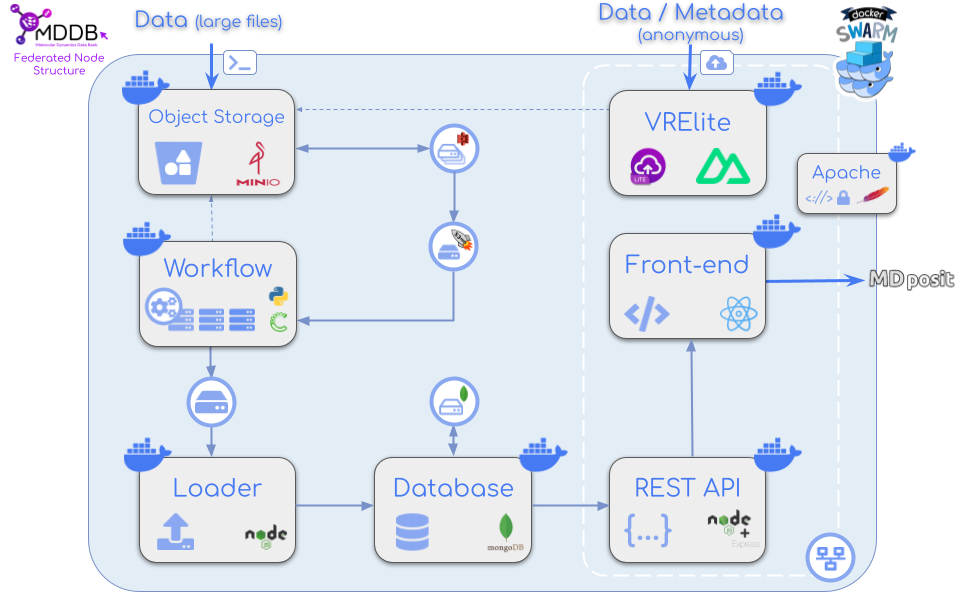
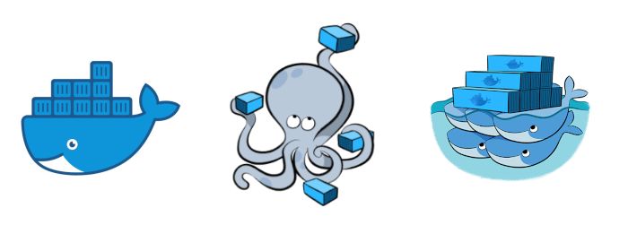

# MDposit - MDDB container services

In this repository there are all the files needed for executing the different **MDposit - MDDB services**: **apache**, **front-end**, **back-end**, **workflow**, **database**, **data loader**, **Object storage** and **VRE lite**. All these services have been integrated into **containers** and connected between them via docker/podman **network**. 

<div align="center" style="display:flex;align-items:center;justify-content:space-around;padding:20px 0;">
<a href="https://mdposit.mddbr.eu/"></a><a href="https://mddbr.eu"></a>
</div>

Schema of **MDposit - MDDB container** web services. Each box in the schema is a **service** encapsulated into a **docker/podman container**. The **services** cover the entire process from the **raw data** to the **website analyses**. See the following figure:

<div align="center" style="display:flex;align-items:center;justify-content:space-around;">

</div>

## Services description

### Apache

The Apache HTTP Server, colloquially called Apache, is a **Web server** application notable for playing a key role in the initial growth of the World Wide Web:

https://hub.docker.com/_/httpd

### REST API

The **REST API** is a **NodeJS + Express** application.

For this project, the following repo has been used:

https://github.com/mmb-irb/MDDB-REST-API/

### Website client

The **website client** is a **React App**, built from its source code when the client image is built. Each node can have its own configuration in `client/host-config.js` (see the [client README](client/README.md)).

For this project, the following repo has been used:

https://github.com/mmb-irb/MDposit-client/

### Data loader

The **data loader** is a **Node.js** tool to load, list and remove data from the MongoDB database (its image also has GROMACS, from a conda environment).

For this project, the following repo has been used:

https://github.com/mmb-irb/MDDB-loader/

### Workflow

The aim for this tool is to **process raw MD data** and obtain standard **structure** and **trajectory** files.

For this project, the following repo has been used:

https://github.com/mmb-irb/MDDB-workflow/

### VRE lite

The **VRE lite** is a **Nuxt** application.

For this project, the following repo has been used:

https://github.com/mmb-irb/mddb-vre/

### Database

The database used is **mongodb** inside a docker container:

https://github.com/docker-library/mongo

For this project, the chosen version of **mongo** is **8.0** (the long-term support release). To upgrade an existing node from an older version, see [mongo-upgrade.md](readme/mongo-upgrade.md).

### Database backup

A specific service performs a complete database backup every `DB_BACKUP_INTERVAL` seconds. To disable it, set **DB_BACKUP_REPLICAS** to 0. See [MongoDB backup service](readme/docker-swarm.md#mongodb-backup-service).

### Utils

One-off utility scripts (e.g. updating the service versions shown in VRE lite). See the [utils README](utils/README.md).

### Object Storage

In order to provide the users a way to **transfer big files** that can't be uploaded via web, a docker **MinIO** server is integrated into the infrastructure.

https://hub.docker.com/r/pgsty/silo (a maintained fork of MinIO)

### Extensions

**Optional** services that may be **deployed** or **omitted**, depending on the node’s requirements: `mcp` (MCP server for the REST API), `metrics` (Prometheus exporters) and `grafana`. See [extensions](readme/config.md#extensions).

## Install a new node with Docker Swarm (recommended)

<div align="center" style="display:flex;align-items:center;justify-content:space-around;">

</div>

There are three ways to install a node, from the easiest to the most detailed. All of them start by cloning this repository in the VM:

```sh
git clone https://github.com/mmb-irb/MDDB-docker.git
cd MDDB-docker
```

### Option A: with Claude Code

If you use [Claude Code](https://claude.com/claude-code), open it in the cloned folder and ask it to *deploy a new node*. The repository has a skill, [deploy-node](.claude/skills/deploy-node/SKILL.md), that guides it through the whole installation: it checks the VM first ([preflight.sh](.claude/skills/deploy-node/preflight.sh)), asks you the values of the node, deploys, and checks the result ([verify.sh](.claude/skills/deploy-node/verify.sh)). It asks before any step that needs sudo or that changes the machine.

### Option B: with the scripts

Two scripts do the work and ask for the values they need:

```sh
python3 scripts/docker-install.py      # installs Docker (skip it if Docker is already installed)
# log out and back in, so your user can use docker without sudo
python3 scripts/docker-deploy.py       # creates the storage folders and the .env, builds and deploys
```

* [docker-install.py](scripts/docker-install.py) installs Docker Engine and the Compose plugin on Ubuntu, Debian, Rocky / AlmaLinux / RHEL, CentOS and Fedora, following Docker's official instructions, and adds your user to the `docker` group (it needs sudo). With `--root-dir /path/to/volume` it also moves the Docker images to that disk, since they need tens of GB. On any other system it points to [Docker's installation guide](https://docs.docker.com/engine/install/).
* [docker-deploy.py](scripts/docker-deploy.py) asks for the storage path, the node name, the host name (or IP) users will use to reach the node, and the users of the database and MinIO, with random passwords unless you type them. If you have no TLS certificate, it creates a self-signed one, enough for an internal node. Then it creates the `.env`, starts Docker Swarm, builds the images and deploys. The build takes a while.

Then [check the node](#check-the-node). The `.env` it creates has the main values only: see [the configuration](readme/config.md#env-file) for the rest (resources, extensions...). If a `.env` already exists, the script uses it as it is.

⚠️ `docker-deploy.py -r` first **removes the stack, leaves the swarm and deletes all the Docker cache**: never use it on a node with services you want to keep.

### Option C: step by step

The same steps as the scripts, by hand. The commands use `my_stack` as the stack name: use the `STACK_NAME` of your `.env`.

1. **Check the VM** meets the [requirements](readme/setup.md#requirements): Linux, a CPU with AVX (`grep -wo avx /proc/cpuinfo | head -1` must print `avx`), enough disk, and internet access to download the images and the code of the services.

2. **Install Docker** with `python3 scripts/docker-install.py`, or by hand: [Set Up Virtual Machine](readme/setup.md#installation-of-docker-and-docker-compose).

3. **Create the storage folders** ([details](readme/storage.md)):

    ```sh
    mkdir -p /path/to/volume/{certs,data,db,db_backup,logs,minio/disk1}
    ```

4. **Put a TLS certificate in `certs/`**: the certificate and private key Apache uses to serve the node over `https`. If you have none, create a self-signed one for the name users will use to reach the node (browsers will show a warning):

    ```sh
    openssl req -x509 -newkey rsa:2048 -nodes -days 3650 -subj "/CN=<host name>" \
      -addext "subjectAltName=DNS:<host name>" \
      -keyout /path/to/volume/certs/selfsigned_privkey.pem -out /path/to/volume/certs/selfsigned_fullchain.pem
    ```

    (with an IP address instead of a host name, use `subjectAltName=IP:<ip>`).

5. **Configure the `.env` file**: copy the template and fill in every empty variable (paths of step 3, node name, host name, certificate file names, and a different generated password for every user). Read the rules in [Set Up Configuration Files](readme/config.md#env-file) first, and validate the result:

    ```sh
    cp .env.docker.git .env && chmod 600 .env
    docker compose -f docker-compose.yml config -q
    ```

6. **Configure the website client** (optional): to give the website its own name, logos, colors and contacts, create `client/host-config.js`. Without it the client uses a generic MDposit look. See the [client README](client/README.md#host-configuration-file).

7. **Start Docker Swarm and create the networks:**

    ```sh
    docker swarm init --advertise-addr <private IP of the VM>
    for n in web_network data_network minio_network metrics_network; do
      docker network create --driver overlay --attachable "$n"
    done
    ```

8. **Build the images and deploy the stack** (with extensions, add `-f` / `-c extensions/<extension>.yml` to both commands; [details](readme/docker-swarm.md)):

    ```sh
    docker compose -f docker-compose.yml build
    python3 scripts/stack-deploy.py -t my_stack
    python3 scripts/update-services-versions.py   # stores the versions shown in VRE lite
    ```

### Check the node

```sh
docker stack services my_stack          # every service at its number of replicas (loader, workflow and utils at 0/0)
docker compose run --rm loader list     # the loader reaches the database
```

Then open `https://<host name>/`, `https://<host name>/api/rest/` and `https://<host name>/vre_lite/` in a browser. If the REST API answers `500` right after the first deploy, restart it once MongoDB is up: `docker service update --force my_stack_rest`. More checks: [Execute services](readme/docker-swarm.md#execute-services).

### After the installation

* **Load data:** run the [workflow](readme/docker-swarm.md#use-workflow) and the [loader](readme/docker-swarm.md#use-loader).
* **Backups:** check the [MongoDB backup service](readme/docker-swarm.md#mongodb-backup-service) and keep the backups on another disk.
* **Settings of this node only** (extra ports, mounts...): put them in `docker-compose.node.yml`, never in `docker-compose.yml` ([why](readme/docker-swarm.md#redeploying-a-running-stack)).
* **Updates:** [Update services](readme/update.md).
* **Problems:** [Tips](readme/tips.md) and [troubleshooting of new nodes](.claude/skills/deploy-node/troubleshooting.md).

### Make the node public

Only if the node must be reachable from the internet:

1. Point a **domain name** to the VM in the DNS. If it is not the host name you gave in the `.env` (`MINIO_URL`, `REST_URL`, `MINIO_BROWSER_REDIRECT_URL`), change them and rebuild the services that use them: `python3 scripts/rebuild.py -s apache rest vre_lite -t my_stack`.
2. Open the ports **443**, **80** and the MinIO API port (`APACHE_MINIO_OUTER_PORT`, e.g. 9000) to the internet ([firewall and ports](readme/setup.md#firewall-and-ports)).
3. Replace the self-signed certificate with a real one: copy yours into `certs/`, or get a free one from Let's Encrypt with automatic renewal ([certificates](readme/storage.md#certificates)). Set its file names in `SSL_CERTIFICATE` / `SSL_CERT_KEY` and rebuild Apache: `python3 scripts/rebuild.py -s apache -t my_stack`.

### Documentation

* [Set Up Virtual Machine](readme/setup.md)
* [Set Up Storage](readme/storage.md)
* [Set Up Configuration Files](readme/config.md)
* [Deploy Docker Swarm](readme/docker-swarm.md)
* [Update services](readme/update.md)
* [Upgrade MongoDB](readme/mongo-upgrade.md)
* [Tips](readme/tips.md)

## Installation via Podman

<div align="center" style="display:flex;align-items:center;justify-content:space-around;">

</div>

### Clone repository

First off, please **clone this repository** into the VM where the services will be deployed:

```sh
git clone https://github.com/mmb-irb/MDDB-docker.git
```

Then, enter the new folder:

```sh
cd MDDB-docker
```

Once the repository has been cloned, there are two ways to deploy it: [**via script**](#via-script) and [**manually, step by step**](#manually-step-by-step).

### Via script

A **deploy script** is provided for executing the **different steps** of the deploying process in an almost **automatic** way. Please execute the script, located in [**scripts/podman-deploy.py**](./scripts/podman-deploy.py). This script [**deploys all the services**](#deploy-podman-stack) with Podman.

How to execute the help script from the root of this repository:

```sh
python3 scripts/podman-deploy.py -h
```

#### Deploy Podman stack

Execute script for deploying Podman Stack:

```sh
python3 scripts/podman-deploy.py
```

Or, for a new clean installation (**remove all the containers** and **Podman cache** before deploying the stack):

```sh
python3 scripts/podman-deploy.py -r
```

Besides, a `.env` file will be created taking [**.env.podman.git**](./.env.podman.git) as a template. For more information about all the **environment** variables that are set in this file, please visit the [**configuration section**](./readme/config.md#env-file). Take into account that only the main environment variables will be created interactively. In some cases this `.env` file must be modified manually.

When executing the **deploy script**, the user will be prompted to answer some questions for filling some of the **variables** in the `.env` file:

⚠️ Review the defaults below: never keep example passwords such as `root` or `secretpassword` in a real node.

* **Main path for the storage system:** At the beginning of the execution of the script, you will be asked for the **main path of the storage system**. Inside this path the following **folder structure** will be generated:

  * [**certs/**](readme/storage.md#certificates) (apache **SSL/TLS** certificates)
  * [**data/**](readme/storage.md#workflow) (**workflow** output data and **loader** input data)
  * [**db/**](readme/storage.md#mongodb) (**MongoDB** data)
  * [**logs/**](readme/storage.md#logs) (**VRE lite** logs)
  * [**minio/**](readme/storage.md#minio) (**MinIO** data)
    * disk1/ (**MinIO** data)

* **SSL/TLS certificates:** If the **SSL/TLS** certificates are available, they can be copied into the **certs/** folder during the execution of the **script**. Be sure to have them located in the **same VM** where the script is being executed.
* **Node:** Node identifier, mandatory. 
* **Database name:** MongoDB database name. Default value: **mddb_db**.
* **Root database user:** MongoDB root database user. Default value: **root**.
* **Root database password:** MongoDB root database password. Default value: **root**.
* **R/W database user:** Read / Write database user for the loader service. Default value: **user_rw**.
* **R/W database password:** Read / Write database password for the loader service. Default value: **pwd_rw**.
* **R database user:** Read database user for the REST API service. Default value: **user_r**.
* **R database password:** Read database password for the REST API service. Default value: **pwd_r**.
* **MinIO root user:** MinIO root user. Default value: **admin**.
* **MinIO root password:** MinIO root password. Default value: **secretpassword**.
* **API MinIO port:** Port for the MinIO API. Default value: **9000**.

Once the deploy has finished, the services should be up and running and the one-off tasks ready to execute. For checking and/or executing all the services, [**please click here**](readme/podman.md#execute-services).

⚠️ **Although all the steps of the installation and deployment are automatic, it's highly recommended to read all the documentation before running this script** ⚠️ 

The different sections of the documentation are:

* [**Set Up Storage**](readme/storage.md)
* [**Set Up Configuration Files**](readme/config.md)
* [**Deploy Podman**](readme/podman.md)

### Manually step by step

Please execute the following steps for installing the **MDposit - MDDB container services** manually:

#### Set Up Storage

The **Object Storage** and **Mongo** services will need a **disk path** to save all the **data** generated. The **Workflow** and the **Loader** services will need **another disk path** as well for **saving** (in the case of the workflow) and **retrieving** (in the case of the loader) the data that will be **uploaded** to the **website** in the last instance.

[**Click here for seeing the detailed instructions for setting up the Storage**](readme/storage.md)

#### Set Up Configuration Files

First off, all the **environment files** must be created and updated as well as the **docker-compose.yml** and **mongo-init.js** files. 

[**Click here for seeing the detailed instructions for setting up the Configuration Files**](readme/config.md)

#### Deploy Podman

Once the Virtual Machine has all the **dependencies installed** and all the **config** files are **set up**, it's the moment of **building** and **running** the **Podman containers**.

[**Click here for seeing the detailed instructions for building and running Podman**](readme/podman.md)

### Tips

A list of **useful tips** for **developing** and **debugging** has been defined for the sake of easing all the process.

[**Click here for seeing the Tips**](readme/tips-podman.md)

## Credits

Daniel Beltran, Genís Bayarri, Adam Hospital, Rubén Chaves.

## Copyright & licensing

This website has been developed by the [MMB group](https://mmb.irbbarcelona.org) at the [IRB Barcelona](https://irbbarcelona.org).

© 2024 **Institute for Research in Biomedicine**

Licensed under the **Apache License 2.0**.